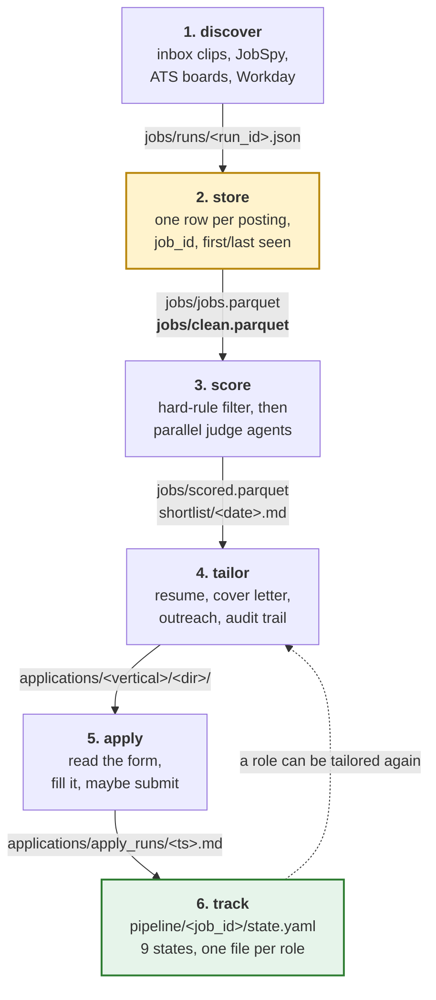

# ApplYourself

A job-search pipeline you run yourself, on your own machine, over your own
resume. It scrapes postings, scores them against a profile you write, drafts
tailored resumes and cover letters, and can fill and submit an application form
for you, with you in the loop at every point that matters.

<p align="center">
  
</p>

**It's for you if** you are applying to a lot of roles across a few different
kinds of job, you want the sifting automated but the writing to still sound like
you, and you are comfortable running things from a terminal.

**It's not for you if** you want a hosted service, a web UI, or something that
applies to hundreds of jobs while you sleep. This is a repo you clone, a profile
you fill in by hand, and a set of commands you run when you decide to.

It needs [Claude Code](https://claude.com/claude-code), because the slash commands
are where the scoring, the writing and every judgment call actually happen.

## What it writes, and what it sends

Everything this repo produces lands on your disk. Outreach messages and cover
letters are **written to files and nothing more**. Nothing here emails, DMs,
or posts anywhere.

Application *submission* is the one exception. `/apply` drives a real Chrome
(Playwright) and can fill and submit an employer's form. It is opt-in per run:
the default fills and stops, and only `apply run --submit` presses submit. It
lists the roles first and asks you to type a confirmation, unless `--yes` is
passed. Submission works on **Greenhouse, Lever and Ashby only**. Workday,
LinkedIn, Indeed and company careers pages are always manual-apply. They get
discovered and scored like anything else, and never submitted to.

> **Two things to know before you use `--submit`.**
>
> **The typed confirmation is `/apply`'s own.** `/apply` passes `--yes` because
> its step 6 shows you every answer and waits for your OK. `/apply <job_id>
> --submit` submits for real once you confirm there.
>
> **Filling is not a dry run.** A fill uploads your resume and cover letter to
> the ATS before any submit decision is made. A default `apply run` leaves files
> on the employer's server. It just doesn't press the button.

It is sponsorship-aware throughout. The scoring filter drops postings that
state a hard ineligibility, and the outreach drafts have per-channel rules for
when to raise work authorization.

## The pipeline

Six stages. Each one writes a file, and the next one reads it, so you can stop
anywhere, look at what happened, and pick up later.



`jobs/clean.parquet` is the **only** discovery output anything downstream reads.
A run works like this:

1. **Pick due boards.** Each board in `data/universe/boards.csv` is checked when `every_days` have passed since its last
   check (`jobs/boards.parquet`); due boards run oldest first.
2. **List and gate.** Each lane lists its boards or runs its searches, and every
   title goes through the lane's title gate right away.
3. **Known or new.** A posting the store already holds is only touched (or
   refreshed, when the list carries its JD). A new one gets its JD fetched once,
   then a `job_id`: a known url, else a known company + title pair, else the
   same role from a different source, else the hash. Two postings of one board
   never merge, and "Senior Engineer" never merges into "Engineer".
4. **Save as it goes.** The store is written every few minutes, so a killed run
   loses little and the next run finds the unchecked boards still due.
5. **Build the view.** `clean.parquet` is every job seen within `live_days`,
   through the title gate and location allowlist, one row per `job_id`, kept for
   60 days from first seen at fit >= 80 (or unscored and not dropped by
   `score start`'s rules), else 15. Roles you are
   actively tracking are always in.

A stored posting never changes its `job_id`, so a role you have on file never
moves.

Scoring puts a keeper list in `shortlist/<date>.md`: the top 25 per lane, minimum
fit 50, and **each lane ranks independently**. A score in one lane is never
compared to a score in another.

## Lanes ("verticals")

A **vertical** is a job lane, one distinct kind of role you're pursuing. Say
you're open to two quite different jobs. Each lane gets its own search terms,
title classifier rules, drop rules, scoring rubric, tailoring defaults, and
the resume it gets judged against. A posting is classified into exactly one lane
at fetch time, scored against that lane's rubric, and tailored from that lane's
resume.

Lanes are **pure config**. `src/` hardcodes no lane, no search term, no company.

Run `/new-vertical` to add one. It's quick mode: it drafts the block the loader
requires, one classifier rule, the rubric, the tailoring defaults and the lane's
resume, then asks a single confirm-or-edit. `/tune-vertical <name>` is the deep
pass afterwards, once you've seen real postings in the lane.

<details>
<summary><b>The vertical config schema</b></summary>

Config lives in `profile/verticals.yaml` (gitignored user data), with a matching
`profile/verticals/<name>/` directory holding `rubric.md` and `tailoring.md`.
Each block's `resume:` key holds the lane's resume shape: section order, bullet
budget, skill line labels and a baseline summary.
`profile/verticals.example.yaml` documents every field, and
`profile/verticals/example_*/` show the per-lane files.

- Vertical names must match `^[a-z][a-z0-9_]*$`, because they become parquet
  values, `applications/<name>/` directories, and staging-file suffixes.
- Mapping order under `verticals:` sets shortlist section order. First is primary.
- `classifier_rules` order is the ambiguity policy: first match wins. One lane
  may own several rules at different priorities.
- `drop_phrases` drops a row whose JD holds one (whole words). `years` maps
  required years to a seniority cap, and a JD asking more than the largest key
  is dropped. Level words in titles go in `title_exclude_terms`.
- `title_include_terms` is an optional include-gate for when a board fuzzy-matches
  your search terms into hundreds of off-lane titles a blocklist can't keep up
  with. Off by default.
- `skill_weights` are 0-10 integers, consumed by the judges, opaque to `src/`.
- `salary_expectation` is read only by `/apply`, only for lanes that set it.

`src/shared/verticals.py` is the single loader and it is **strict**: a vertical block
missing any required key raises `ValueError`. Because `tests/conftest.py` injects
config through an autouse fixture, one malformed block errors the entire test
suite. `uv run verticals-check` fails loud if a rubric, tailoring file or
`resume:` block is missing, or if any pointer between the resume sources
(`resume.yaml`, `bullets.md`, `skills_master.md`) no longer resolves.

</details>

<details>
<summary><b>Adding a lane by hand</b></summary>

`/new-vertical` exists because copying `profile/verticals/example_primary/` is
not enough on its own. You also need, in `profile/verticals.yaml`, the block key,
its `display_name`, its `resume:` shape and the `vertical:` values in
`classifier_rules`; and on the shared sources, the lane's `lanes:` budgets in
`resume.yaml`, `default_for` on its baseline bullets and `show` on its skills.
`verticals-check` names whatever is missing.

</details>

## Start here

You need [uv](https://docs.astral.sh/uv/), Python 3.12 (pinned `>=3.12,<3.13`),
and Claude Code. PDF output additionally needs Microsoft Word on macOS, which
it drives via `osascript`. Everything else runs anywhere Python does; without Word
a build fails unless you pass `uv run app build ... --no-pdf`, which writes only the `.docx`.

**1. Install and prove the clone works.** The core install needs no C toolchain.

```bash
git clone <this repo> && cd <repo>
uv sync
uv run pytest tests -q --ignore=tests/discovery   # should be fully green
```

**2. Install libpostal.** The location filter needs the system
**libpostal** C library and its Python binding, with no fallback parser, and
every ingestion path rebuilds `clean.parquet` through it — including the scrape
`/onboarding` does at its step 1. This is the one genuinely annoying install.

```bash
brew install libpostal            # macOS. On Linux, build from source first.
uv sync --group discovery
uv run python -c "import postal.parser"   # must exit 0
uv run pytest tests -q            # the discovery tests can run now too
```

**3. Fill in your profile.** In Claude Code:

```
/onboarding
```

Five steps, about 21 minutes, eight questions instead of the 33 decisions the
by-hand path asks for: the roles you want, your work authorization, an
experience cap, a target level and one confirm-or-edit on your first lane, two
on what it inferred, and one against real scored postings, which are on screen
by minute 17. The scrape starts while it reads your resume, and the scoring runs while you
answer the review questions. It drafts every `profile/` file for you, showing
you only the handful of lines it had to interpret. It's
resumable: stop after any step and re-run to continue, or `/onboarding step <n>`
to jump.

Already set up and want a health check? `/onboarding audit` reports what's
missing or invalid and changes nothing. Prefer to do it by hand?
`uv run onboard-scaffold --vertical <lane> --work-auth <status>` does the
mechanical half — every `profile/*.example.*` copied to its real name, the
example lanes stripped out of `verticals.yaml`, your home country's
work-authorization row set in `application_answers.yaml` — and leaves the writing to you. It leaves `verticals.yaml`
without a lane, so it won't load until `/new-vertical <lane>` writes one. See
[What only you can supply](#what-only-you-can-supply).

**4. Check your config loads.**

```bash
uv run verticals-check     # prints your lanes, or fails with what's missing
```

**5. Get more jobs in.** Either scrape overnight, or start with a single
posting:

```bash
uv run discover                                  # the full run
uv run ingest-url <a job posting URL>            # or just one
```

In Claude Code, `/ingest <url> <vertical> resume cover-letter` runs the whole
chain on one posting (ingest, score, tailor, letter) and stops before
applying.

**6. Score, then tailor.** In Claude Code:

```
/score                    # writes shortlist/<date>.md
/tailor <job_id>          # resume + audit trail for one role
/cover-letter <job_id>    # when the board wants a letter
/apply <job_id>           # fills the form; submits only if you say so
/track <job_id> applied   # you, or /apply, moving the role forward
```

Read the shortlist before you tailor. It's the whole point of the scoring stage.
`/apply` needs one more install, and Linux needs a longer libpostal story. Both
are in the block below.

<details>
<summary><b>Extra installs: Linux libpostal, and the `/apply` browser</b></summary>

**libpostal on Linux.** No distro packages it. Build from source
([openvenues/libpostal](https://github.com/openvenues/libpostal)) and budget for
it: the build downloads roughly 2GB of model data, and the development headers
must be present for the `postal` Python binding to compile. Needs
`autoconf`, `automake`, `libtool`, `pkgconf` and a compiler. If you used a
non-default `--prefix`, export `LIBPOSTAL_PREFIX` and `LD_LIBRARY_PATH`. See the
CI workflow in `.github/workflows/ci.yml` for a working recipe.

**The `/apply` browser.** An opt-in group that needs a Chrome to drive. Every
other stage works on a clone that never installs it.

```bash
uv sync --group apply
PLAYWRIGHT_SKIP_BROWSER_DOWNLOAD=1 uv run playwright install chrome   # macOS
```

It drives a separate, empty Chrome profile at `.apply_profile/`, never your own
browser session.

</details>

<details>
<summary><b>Running discovery nightly (macOS)</b></summary>

`scripts/nightly_pipeline.sh` plus `scripts/launchagent.example.plist` schedule
the night at 20:00, wrapped in `caffeinate` so sleep doesn't kill it mid-run. A
`launchd` job whose start time falls while the Mac is asleep is skipped rather
than deferred, so it needs a `pmset` wake a few minutes earlier. `/onboarding`
prints the install block for you at the end. The script deletes discovery logs and run folders
older than `log_keep_days` in `profile/discovery.yaml`.

The same script then scores, adds synonyms, tailors, fills forms without submitting
and writes `summary.md`; a failed discover or score stops it.

</details>

<details>
<summary><b>What a night actually polls</b></summary>

Which boards are due is step 1 of [the pipeline](#the-pipeline). The settings
live in `profile/discovery.yaml`:

- **`every_days` per board lane.** Greenhouse, Lever and Ashby ship at 1;
  Workday, the slowest lane per kept row and manual-apply anyway, at 3, so a
  third of its tenants run each night.
- **Dead boards.** Three 404s in a row mark a board `dead`, re-checked every
  `dead_every_days`. That only sees boards that stopped answering — a board
  serving 200 with no postings looks healthy, which is what
  `scripts/audit_slugs.py` and the digest's `never_found` count measure.

`uv run discovery-check` prints the config these resolve to before you run
anything, and `discover` runs it as preflight.

</details>

## Commands

The slash commands are the product. `src/` on its own is a scraper, a docx
renderer and a form filler; Claude Code runs the half that decides things.

**Read a command's `.md` before running it.** The real orchestration logic lives
in `.claude/commands/`, not in `src/`.

### Slash commands

| command | what it does | writes |
|---|---|---|
| `/onboarding` | Five-step resumable setup: eight questions, ~21 minutes, real scored jobs at step 4. Also runs as an audit (`/onboarding audit`). | every `profile/` file, `profile/.onboarding.md` |
| `/discover` | Run the nightly scrape, then read its own run report back: a ≤10-line health digest of tonight's run against that source's own 7-day median. Read-only on every report. | `jobs/` only |
| `/score [--all] [--vertical V]` | Score new rows and regenerate today's shortlist. Fans out judge agents over staged slices. `--all` re-judges every role not past saved/tailored; `--vertical` limits it to one lane. | `jobs/scored.parquet`, `shortlist/<date>.md` |
| `/tailor <job_id>` | One-page ATS-clean tailored resume. You choose bullets and wording; code assembles, checks, renders and traces it. | `applications/<vertical>/<dir>/`: `jd_snapshot.md`, `resume_plan.yaml`, `trace.md`, `_Resume.docx`, `_Resume.pdf` |
| `/cover-letter <job_id>` | One-page letter into that role's folder, drawn from the bullets on its resume. | `cover_letter.yaml`, `_Cover_Letter.docx`, `_Cover_Letter.pdf` |
| `/company-answers <job_id> [--refresh]` | Research the company and write its "why us" answers once. No letter. | `company_answers.yaml` in the role's folder |
| `/apply <job_id> [--submit] [--letter]` | Resolve the judgment-only form questions, then fill, or submit. `--letter` attaches a cover letter even when the board does not ask. | `answers_override.json`, the answer bank in `application_answers.yaml`, `applications/apply_runs/<ts>.md` |
| `/outreach <job_id> <channel> --to "Name"` | Draft a recruiter, referral or alumni message in your voice. Never sends. | `pipeline/<job_id>/outreach/<date>_<channel>_<who>.md` |
| `/interview <job_id \| vertical>` | Mock interviewer. Drills you on the claims your own resume makes, depth-first, and keeps a cross-session worklist of the ones that didn't hold. Never writes to `profile/` or `state.yaml`. | `interview/` (gitignored) |
| `/track <job_id> <state>` | Move a role through the state machine. The **only** writer of state. | `pipeline/<job_id>/state.yaml` |
| `/standup` | Rebuild the whole-pipeline view. Read-only on state. | `pipeline.md` |
| `/ingest <url> <vertical> [resume] [cover-letter]` | Single-URL fast path: ingest, score one row, tailor, letter. Stops before applying. | everything the chained commands write |
| `/new-vertical <name>` | Quick-add a lane as pure config: the loader's minimum, one confirm-or-edit. | `profile/verticals.yaml` block + `profile/verticals/<name>/` |
| `/tune-vertical <name>` | Deep tuning pass on a lane that already exists, against rows you've seen: search terms, `skill_weights`, the title gate, classifier collisions, drop rules, rubric tiers, the resume shape. | the same two, edited in place |
| `/suggest-synonyms` | Three-track audit of your bullets and skills against real shortlist keywords. Proposes, never edits. | `profile/synonyms_draft_<date>.md` |
| `/no_ai_slop` | Editor pass: sharpen a draft, or name its AI-slop patterns without rewriting. | nothing; returns the edit in conversation |

The judge is a subagent, not a command: `.claude/agents/score-judge.md`, spawned
per slice group by `/score` and `/ingest`. Never invoke it directly.

### Deterministic CLIs

Every entry point in `pyproject.toml [project.scripts]`. These never call an LLM.

| command | what it does | writes |
|---|---|---|
| `uv run discover [--deadline-hours H] [--source NAME] [--max-terms N] [--jobs-dir D] [--boards-dir D]` | Overnight scrape into the jobs store, then the `clean.parquet` rebuild. The overrides narrow one run without touching config; `--source` is repeatable and exhaustive, so naming one excludes the inbox. Needs `--group discovery`. | `jobs/jobs.parquet`, `jobs/boards.parquet`, `jobs/clean.parquet`, `jobs/raw/<run_id>.parquet`, `jobs/runs/<run_id>.json` + `.md` |
| `uv run ingest-url <url> [--vertical V] [--company C] [--title T] [--dry-run]` | One posting into the store, then a `clean.parquet` rebuild. Needs `--group discovery`. | `jobs/jobs.parquet`, `jobs/clean.parquet` |
| `uv run verticals-check` | Validate config, every per-lane rubric and tailoring file, and the resume sources. | nothing |
| `uv run config-check` | Load and validate every `profile/` config file; one OK or ERROR line per file, exits 1 on any error. An unknown key names the closest valid one. | nothing |
| `uv run discovery-check` | Resolve and validate the discovery config: prints the effective location allowlist, the JobSpy search locations and the enabled sources, exits 1 on any problem. `discover` runs it as preflight. | nothing |
| `uv run discover-digest [--json] [--run-id ID] [--window N] [--runs-dir D]` | Read the recent `jobs/runs/*.json` reports and print the trend facts `/discover` renders: per-lane rows against that lane's own 7-day median, error delta, zero streaks, 403/429 counts, crashed or truncated lanes, dead boards. Reader only. | nothing |
| `uv run onboard-scaffold --vertical V --work-auth citizen\|needs_now\|time_limited [--with-apply] [--with-optional] [--force] [--dry-run]` | Every mechanical setup chore: copy each `profile/*.example.*` to its real name, strip the example lanes from the copied `verticals.yaml` and set `default_vertical`, set your home country's work-authorization row in `application_answers.yaml`, probe for libpostal. `--with-apply` installs the apply dependency group and Playwright's Chrome. Skips any file that already exists unless `--force`. | the copied `profile/` files |
| `uv run score start [--all \| --stale-only [--yes]] [--vertical V] [--job-id ID]` / `uv run score finish` / `uv run score show <job_id>` | `/score`'s plumbing: `start` drops rows by the hard rules (never stored) and stages judge slices; `--stale-only` counts judged rows whose JD or packet changed, `--yes` stages them; `finish` checks the answers, merges and writes the shortlist; `show` prints one role's score, read-only. | `jobs/scored.staging/*`, `jobs/scored.parquet`, `shortlist/<date>.md` |
| `uv run track <job_id> <state> [--note ...]` | One state transition. Also `ensure <job_id>` and `outreach-sent`. | `pipeline/<job_id>/state.yaml` |
| `uv run app new\|dir\|build <job_id>` | The plumbing of `/tailor`, `/cover-letter` and `/company-answers`: open the role's folder, resolve it, and build a resume, letter or answer sheet from the session's YAML. `build` prints problems and exits 2 instead of rendering anything wrong. | the role's `applications/` folder, `tailored_dirs[]` |
| `uv run profile-extract <file>` | Dump a `.docx` or `.md` resume's text. Refuses `.pdf`. | nothing; prints to stdout |
| `uv run apply <subcommand>` | `prepare`, `plan`, `run`, `learn`, `sheet`. Needs `--group apply`. | see below |

Plus three scripts: `./scripts/pii_scan.sh` (the
[PII gate](#before-you-push-the-pii-gate)),
`uv run python scripts/scrub_example_templates.py` (strips Word metadata from
the two tracked `.docx`), and `scripts/audit_slugs.py`, which walks every board
once and says which are active, empty, stale or dead into
`jobs/slug_audit_<date>.csv`. It writes nothing but that CSV.

<details>
<summary><b>What each <code>apply</code> subcommand actually does</b></summary>

| subcommand | behavior |
|---|---|
| `prepare <job_id>` | Check the role (state `saved` or `tailored`, a resume on file), the answer bank and Playwright. Print the role's folder and reset its `answers_override.json`. |
| `plan <job_id> [--json] [--questions] [--answers F]` | Print the fill plan. Writes nothing, opens no browser, except Ashby, where one headless page load fetches field descriptions. `--questions` groups the form: KNOWN (the bank or your facts), GUESSED BY KEYWORD (check these), NEW (not in the bank yet), BLOCKING. Exits 1 if an `--answers` entry cannot apply. |
| `run [--job-id ID] [--answers F] [--manifest F] [--submit] [--yes] [--limit N] [--rate 4m]` | Fill, and click only with `--submit`. **Uploads your documents.** With `--answers` it first saves what your confirmed answers teach to the answer bank. `--manifest` dumps what the page actually holds against the plan. |
| `confirm <answers-file>` | Show an `/apply` answers file and take your typed yes on a terminal. Stores a hash beside the file; `run` and the bank treat the file as confirmed only while it still matches. Refused without a terminal. |
| `learn [--job J] [--undo ID [--wording W \| --keyword K]] [--undo-claim TEXT] [--undo-fact LABEL]` | Review what the answer bank holds, or take one thing back: a question, one wording or keyword of it, a work-authorization claim, or a judged work-authorization / export-control wording. |
| `sheet [--add]` | Rebuild the overnight status sheet (`profile/automation.yaml` `table_path`) from state, the submit ledger and run reports. `--add` first appends roles newly scored at or above `scoring.yaml` `cutoffs.sheet`. |

The submit path is bounded, all in `src/apply_cli.py`:

- `--submit` is off by default and is the only thing that presses submit.
- `apply run --submit` requires an explicit `--limit`, unless `--job-id` names
  one role. It errors before any browser opens.
- It prints the roles it's about to apply to and requires a typed confirmation
  unless `--yes`. A non-tty stdin without `--yes` is **refused**, never
  auto-confirmed.
- `--rate` is clamped to a 30-second minimum, and at most one application per
  company goes out per run. (That last cap applies to submits only; a
  fill-and-stop walk is uncapped.)
- `applications/apply_runs/submitted.jsonl` records every click before it
  happens, and a role in it is never clicked again unless its latest line is
  `refused`. A board that answers "we
  couldn't submit your application" is reported `rejected`, and a click that
  sent nothing is `unsent`; neither is marked `applied`.

A run report lands at `applications/apply_runs/<timestamp>.md`, rewritten after
each role so a crash still leaves the record. Boards that can't be submitted to
get their own `manual` category, not `failed`. After every click `/apply` saves
evidence: `applications/apply_runs/evidence/<ts>_<job_id>.txt` and a full-page
`.png`.

A cover letter is made when the board's form asks for one, when it offers an
upload and `application_answers.yaml` sets `cover_letter: when_offered`, or
with `--letter`.

</details>

## What only you can supply

Every file below has a `.example` template documenting its schema. But the
templates are shapes, not content, and the pipeline will not invent your
experience. Filling them in is the work.

| file | what it is |
|---|---|
| `resume.yaml` | Your name, contact line, education, and one header per job or project with its bullet budget per lane. The only place these lines live. |
| `bullets.md` | Canonical resume bullets. **The source of truth for every generated document.** `/tailor` may reword within the synonyms you allow, never beyond them. `default_for` marks a lane's baseline picks. |
| `skills_master.md` | Your skills inventory. The Skills section is assembled from here, not written fresh; `show` places each skill on a lane's lines. |
| `voice_samples.md` | Messages you actually sent, so outreach sounds like you. `/outreach` **refuses to run** without it, and there is no generic-voice fallback. |
| `application_answers.yaml` | The standing answers `/apply` fills forms from: contact details, work authorization, demographics, links. A field it can't resolve here parks the role instead of guessing. Its `claims`, `questions` and `fact_wordings` grow with each confirmed `/apply`. |
| `verticals.yaml` | Your lanes. See [Lanes](#lanes-verticals). |
| `discovery.yaml` | Sources, deadlines, location allowlist, retention. |
| `contacts.yaml` | People to reach out to. Optional. |
| `resume_template.docx` | Word template whose five named paragraph styles the renderer fills. Its body text is discarded. |
| `cover_letter_template.docx` | Your own letter design. Everything that isn't a `{{PLACEHOLDER}}` is **preserved into every letter**, so nothing decorative is free. |

Also in `profile/`, but rules rather than personal data:

- `de_ai_rules.yaml` ships as a committed default: the banned phrasing, the
  mechanical replacements, and the stopwords a reworded bullet may add. Your
  sources are linted against it once, by `verticals-check`.
- `scoring.yaml`, copied from `scoring.example.yaml`, holds the scoring policy:
  the `ineligible` drop list, the action thresholds and the shortlist size. Your
  sponsorship need per country comes from `application_answers.yaml`'s
  work-authorization table.

The shared judging guide (the four axes, the answer fields, the sponsorship
vocabulary) is `.claude/shared/scoring_rubric.md`, committed, layered under each
lane's own `rubric.md`. The judge reports what the JD says; Python derives the
sponsorship label.

The `profile/` files you fill in are **gitignored user data**. Nothing you write
into them is ever committed. What *is* tracked there is only scaffolding: the
`.example.*` templates, the `example_*` lane directories, and `de_ai_rules.yaml`.

<details>
<summary><b>The two Word templates, and why they have their own guard</b></summary>

`profile/*.example.docx` are the repo's only tracked binaries. The PII gate
allowlists them by name, so neither its binary check nor its text scan reads
them, and `tests/test_example_templates.py` stands in for the scan it skips.

Every string they contain is a generic stand-in: `Name`, `City, ST`,
`Bullet Text 1`. The tests fail on any text outside that approved set, on
document metadata, and on an unexpected part appearing inside the archive.

The cover letter's letterhead is **literal text, not a placeholder token**, so
replace `NAME` and the contact line in your own copy or every letter you send is
headed `NAME`.

They're hand-authored in Word, and every save stamps the editor's name into the
metadata, so run this after any edit:

```bash
uv run python scripts/scrub_example_templates.py    # --check exits 1 if needed
```

The pre-push hook runs their test suite too, because CI runs *after* the push,
by which point the blob is public and reachable by SHA forever.

</details>

<details>
<summary><b>Where files land: the data layout</b></summary>

`src/shared/paths.py` is the single source of truth, resolved from the file rather than
the CWD, so a path means the same thing whichever entry point you came in
through.

```
jobs/clean.parquet              the only discovery output downstream reads
jobs/jobs.parquet               the store: one row per posting, job_id, first/last seen
jobs/boards.parquet             one row per board: last checked, last found, counts
jobs/scored.parquet             scores, one row per judged posting
jobs/scored.staging/            per-lane packets, judge slices and answer files
jobs/raw/<run_id>.parquet       debug: every classified listing and its gate verdict
jobs/runs/<run_id>.json + .md   the run report
data/universe/boards.csv        the board list
shortlist/<date>.md             today's keepers, sectioned by lane
applications/<vertical>/<dir>/  one directory per tailoring run
applications/apply_runs/        submission run reports and evidence
pipeline/<job_id>/state.yaml    one state file per tracked role, a cache of its events
pipeline/events.jsonl           the append-only history every state.yaml folds from
pipeline.md                     the whole-pipeline view /standup rebuilds
inbox/*.md                      manual JD clips, moved to .processed/ when read
profile/                        your config and content
.apply_profile/                 the throwaway Chrome profile /apply drives
```

`applications/<vertical>/<dir>/` is allocated by `uv run app new` as
`<date>_<company>_<title>_<job_id>`, with `_vN` appended when the role already
has a folder. An unfinished folder is reused, version numbers are never reused, and
everything downstream reads the **last** entry in `tailored_dirs[]`.

</details>

## How it's built

Two rules shape the whole codebase. Everything else is stated inline where it
applies.

<details>
<summary><b>R7: no module under <code>src/</code> ever calls an LLM</b></summary>

`src/` is deterministic plumbing: parquet I/O, config loading, the jobs store, linting,
docx rendering, state transitions. Every act of *judgment* (scoring a posting,
choosing which bullets to tailor, writing a letter) happens inside a slash
command session, which shells out to the `src/` helpers for the deterministic
parts.

That split is what makes the pipeline auditable. No model decides anything
without writing it down, in an artifact stored next to the resume it produced.
And the `src/` half, given the same inputs and the same jobs store, does the
same thing every time.

A corollary: `src/` is vertical-agnostic and company-agnostic. The judge's model
name is read from `.claude/agents/score-judge.md` only to stamp `scored_by_model`.
No client is ever constructed.

`.claude/hooks/r7_no_llm_in_src.sh` enforces this at edit time.

</details>

<details>
<summary><b>R10: <code>/track</code> is the only writer of state</b></summary>

Nine states:

```
saved  skip  tailored  applied  screen
interview  offer  rejected  withdrawn
```

`state_io.ALLOWED` lists the moves; any other, out of the three terminal states
(`offer`, `rejected`, `withdrawn`) included, needs `--force --note "<why>"`. An
`applied` role with no update for `ghosted_after_days` (default 30) shows as
`ghosted`; that state is derived, never stored.

Every transition goes through `/track`. No other command writes `state:` itself.
Other commands append to side lists only: `/tailor` to `tailored_dirs[]`,
`/outreach` to `outreach[]`. A role's letter and company answers are whatever
files its latest folder holds. `/standup` is
read-only and is the sole regenerator of `pipeline.md`. Even `/apply` transitions
to `applied` by calling `track_cli`, never by touching the file.

Two commands fire the `saved -> tailored` self-promotion, both as
`uv run track <id> tailored --if saved`, so they can only fire from `saved`.
Otherwise they'd drag an `applied` role backwards. `/cover-letter` fires it after writing a letter;
`/apply` fires it once its plan-check confirms the board genuinely needs no
letter.

Every change is one line appended to `pipeline/events.jsonl`; each `state.yaml`
is a cache of its role's fold, and `uv run track rebuild-states` remakes it.

`.claude/hooks/state_yaml_guard.sh` blocks the Edit and Write tools from
targeting a `state.yaml` or `pipeline/events.jsonl` at all, since every
legitimate write goes through Bash.

</details>

<details>
<summary><b><code>job_id</code> is a content hash, and load-bearing</b></summary>

```
job_id = sha1(company_normalized + "|" + title_normalized)[:8]
```

URL and `jd_text` are deliberately **excluded**, so the id stays stable across
re-scrapes even when a posting's URL changes or its description is edited.

That stability is what lets `pipeline/<job_id>/state.yaml` and the
`applications/<dir>` names survive. Changing the hash inputs would silently
orphan every one of them. Do not add url or jd_text to the hash.

</details>

<details>
<summary><b>Scoring: what gets skipped before a judge sees it</b></summary>

`/score` runs `uv run score start`, fans out parallel judge agents over the
slices it stages, then runs `uv run score finish`. It never judges a row itself,
and its own context stays counts-only.

`score start` drops rows *before* any judge is spawned. A drop is not stored;
it is checked again on every run. The codes it prints as `dropped_<code>`:

1. **`no-lane`**: the title matched no lane.
2. **`ineligible`**: the JD holds a phrase from `profile/scoring.yaml`
   `ineligible` (whole words; "U.S." reads as "us"). When you need
   sponsorship now at home, the `no_sponsorship` phrases drop too.
3. **`phrase`**: the JD holds one of the lane's `drop_phrases`.
4. **`years`**: the years regex reads more than the lane's largest `years`
   key plus `scoring.yaml` `years_margin`. It reads the *lower* bound, so
   "3-6 years" counts as 3. It is only a pre-filter: for a judged role, the
   judge's years set the seniority cap or force a skip, and `score finish`
   prints a `years_gap` line when the two differ by 3 or more.

Degree requirements are deliberately left to the judge.

A judge reads one packet per lane (shared rubric, lane rubric, resume,
`skill_weights`) plus its slices, and writes one answer file per slice. It
never merges, never touches `scored.parquet`.

The judge reads facts and judges fit. It writes four subscores capped
`title 30`, `skills 30`, `seniority 20`, `domain 20`; the years the JD
requires; the country; what the JD says about sponsorship (`offers`,
`no_sponsorship`, `no_future_sponsorship`, `no_opt_support`, `status_bar`,
`right_to_work`,
`silent`), listing every statement the JD makes, with literal quotes; keywords and a short reason. `score finish`
applies every rule to those facts: the sponsorship label from your need in
the role's country, the lane's years limit and
seniority cap, discovery's countries per lane, the vague-JD skills cap, the
total and the action. A judge may only lower the action.

`/score --all` re-judges every role not past saved/tailored;
`/score --all --vertical <name>` re-judges one lane. Run it after editing your
bullets, a rubric, `scoring.yaml`, or on a model upgrade.

</details>

<details>
<summary><b>Linting: two tiers, and a rewrite loop</b></summary>

`src/lint.py` runs two tiers over every generated document.

**Tier 1: mechanical.** Dashes, smart quotes, ellipses, non-breaking spaces,
zero-width characters. Auto-fixed everywhere, silently.

**Tier 2: banned phrases** from `profile/de_ai_rules.yaml`. Flagged only, never
auto-fixed. The command session loops the model to rewrite until the linter comes
back empty, with a hard cap of **5 attempts**. After that a resume falls back to
its canonical bullets (`--final`) and prose drops the failing sentence. A failed
build writes nothing, and no command deletes a file it did not write.

Company names, the recipient's name, skill names, URLs and dates are never
flagged. Your sources are linted once, at the source, by `verticals-check`, so a
banned phrase in a bullet is fixed in `bullets.md`, not worked around per role.

</details>

<details>
<summary><b>The Claude Code hooks</b></summary>

Three rules are enforced mechanically rather than by memory. All wired in
`.claude/settings.json`, all fail with exit 2.

| hook | when | blocks |
|---|---|---|
| `state_yaml_guard.sh` | before Edit/Write | any edit targeting a `pipeline/*/state.yaml` or `pipeline/events.jsonl` (R10) |
| `r7_no_llm_in_src.sh` | after Edit/Write | LLM SDK imports or API endpoints under `src/**/*.py` (R7) |
| `pii_gate.sh` | before `git commit` | a commit whose index fails `scripts/pii_scan.sh` |

The per-area detail lives in `.claude/rules/*.md`, each scoped by `paths:` so it
loads only when you open the code it governs: `src-boundary`, `state-machine`,
`verticals-config`, `scoring`, `apply-submission`, `linting`,
`profile-templates`, `pii-gate`, `discovery`. Run `/context` to see what actually loaded.

The test suite runs from `.githooks/pre-commit` instead: any commit that stages
`src/`, `tests/`, `scripts/` or `profile/*.example.*` is blocked while the R7
scan or the suite is red, and any commit that stages a `.py` file is blocked on
`ruff check`. Enable it once per clone
with `git config core.hooksPath .githooks`.

</details>

<details>
<summary><b>Reading <code>src/apply/</code></b></summary>

The submission stage is the most layered part of the repo, because every ATS
lies to you differently.

| module | role |
|---|---|
| `detect.py` | URL to ATS name, plus `is_auto_submittable`. Split out so `shortlist.py` can ask without importing the CLI. |
| `greenhouse.py` | Posting URL to token, to embedded form, to a reconciled field list. |
| `domscan.py` | Rendered DOM to field inventory, the source of truth for what must be filled. A pure function over an HTML string: no browser, no network. |
| `schema.py` | Greenhouse's question API to normalized labels, required flags and option lists. Enrichment only. |
| `reconcile.py` | Settles DOM-vs-API disagreements. The DOM decides existence and requiredness; the API contributes labels and options. |
| `lever.py` | Server-rendered form straight to merged fields. Keys off `name`, not `id`. |
| `ashby.py` | Client-rendered, so it POSTs the `ApplicationForm` GraphQL query, plus one headless page load for the per-field description text that query never returns. |
| `answers.py` | Resolves each field to a value from `application_answers.yaml`. Anything unresolvable parks the role, which blocks submit. |
| `bank.py` | The answer bank: saves what each confirmed run teaches, and takes it back for `apply learn`. |
| `plan.py` | Form plus answers to an ordered fill plan. The whole contract with the browser. |
| `fill.py` | Executes the plan and makes the one guarded submit click. Config always wins; a react-select that didn't stick is a failure, not a warning. |
| `ledger.py` | `submitted.jsonl`, the submit ledger: one line per click, read before any click. |
| `sheet.py` | The overnight status sheet, rebuilt from the records that own each fact. |
| `browser.py` | The only module that names Playwright's driver, and it defers the import into a function so a clone without `--group apply` still works. |

</details>

## Tests

```bash
uv run pytest tests -q --ignore=tests/discovery
```

Drop the `--ignore` once you've installed `--group discovery`. Those tests
exercise the real address parser with no stub, so without libpostal they **error
rather than skip**, hence the flag. `tests/test_optional_dependencies.py` is the
one that covers the no-libpostal path, and it always runs.

Tests run against a synthetic three-lane config in
`tests/fixtures/verticals.yaml`, whose three lanes (`example_primary`,
`example_secondary`, `example_tertiary`) come from a fictional
widget/sprocket/cog world. Never your real one.
`tests/test_real_config_drift.py` additionally checks your live
`profile/verticals.yaml` when it exists, structurally, and skips on a fresh
clone with a warning in the summary.

CI (`.github/workflows/ci.yml`) runs the full suite with libpostal built from
source and cached, under `LC_ALL=C` and `PYTHONUTF8=0`, which is how a bare
container and a cron job both run it. It runs the PII gate as a separate job,
using the shipped example denylist, so the documented onboarding path stays
honest.

## Before you push: the PII gate

You will fill your fork with real contact details, real employers, real names. If
you push it anywhere public, `scripts/pii_scan.sh` fails the push when a
denylisted string reaches a tracked file.

```bash
cp profile/pii_denylist.example.txt profile/pii_denylist.txt   # then fill it in
git config core.hooksPath .githooks                            # once per clone
git add -A && ./scripts/pii_scan.sh                            # or run it by hand
```

It's opt-in and off the setup path: `/onboarding` puts it on its later menu
rather than the five steps, because a fork you never push doesn't need it
(`onboard-scaffold --with-optional` copies the denylist template if you want it
early). Set it up before your first push if you do
publish, and work through the categories deliberately: name, email, phone,
address, government identifiers, local filesystem paths, handles, other people's
names, employers and schools.

Your denylist is itself gitignored. The list of strings to keep out is the thing
being kept out.

Three behaviors worth knowing:

- Patterns match **whole words** by default, so a short abbreviation won't flag
  every longer word containing it. Prefix a pattern with `~` when you *do* want
  it to match inside longer words, a handle for instance.
- A missing denylist is an **error**, not a pass. The gate refuses to report a
  scan it never ran. (`PII_SCAN_ALLOW_MISSING=1` downgrades that to a warning for
  a fresh clone.)
- It reads the git **index**, so it only sees tracked files. Run it *after*
  staging, and never put a real pattern in a committed file.

`LICENSE`, the denylist template, `data/universe/boards.csv` and the two example
`.docx` are allowlisted in the script by **exact path, never by glob**. MIT
attribution and vendored company names are supposed to be there. A new universe
CSV isn't covered until it's added to that list by name.

<details>
<summary><b>What the pre-push hook catches that the scan structurally can't</b></summary>

`scripts/pii_scan.sh` reads the index, so it says nothing about a file that was
clean at HEAD but carried PII three commits ago, and pushing publishes every one
of those blobs. `.githooks/pre-push` covers four blind spots:

1. **The pushed commits' content**, via a `-G` pickaxe across the range. An error
   from that scan is treated as an unverified range, not a clean one.
2. **Commit messages, author and committer fields.** That metadata lives in no
   file, and GitHub renders an author email on every commit page.
3. **`user.email` itself**, checked at both local and global scope. A global
   address that differs from the repo-local one is exactly how this leaks.
4. **The two tracked `.docx`**, whose entire guard is
   `tests/test_example_templates.py`, because the pickaxe is text-only and
   emits no diff lines for a Word file.

It fails closed: no `uv` on PATH means the template guard didn't run, which is
not a pass.

`core.hooksPath` is local config and can't be versioned, so a fresh clone has no
hook until you set it. `--no-verify` skips it anyway. CI is the copy of the gate
that neither can reach.

</details>

## License

MIT. See [LICENSE](LICENSE).

The company seed lists in `data/universe/` are vendored from
[kalil0321/ats-scrapers](https://github.com/kalil0321/ats-scrapers) (MIT); see
`data/universe/README.md` for provenance and the refresh procedure.

**On terms of service.** Scraping job boards may conflict with theirs. Whether to
run this, and against what, is your call. The same goes for `/apply`, which
automates form filling and submission into third-party ATS systems, and some of
those services restrict automated submission explicitly. Read them and decide for
yourself.
